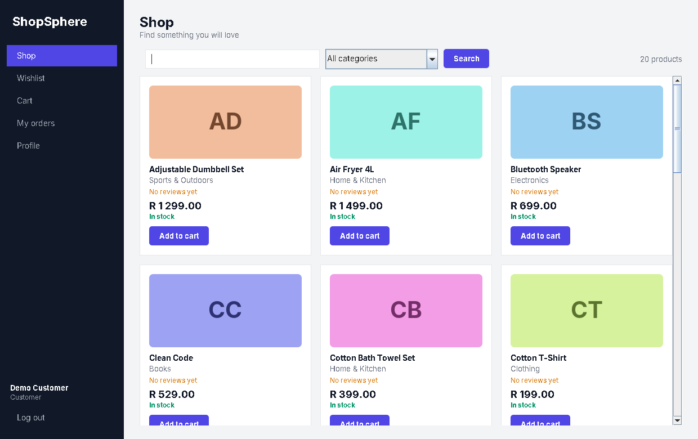
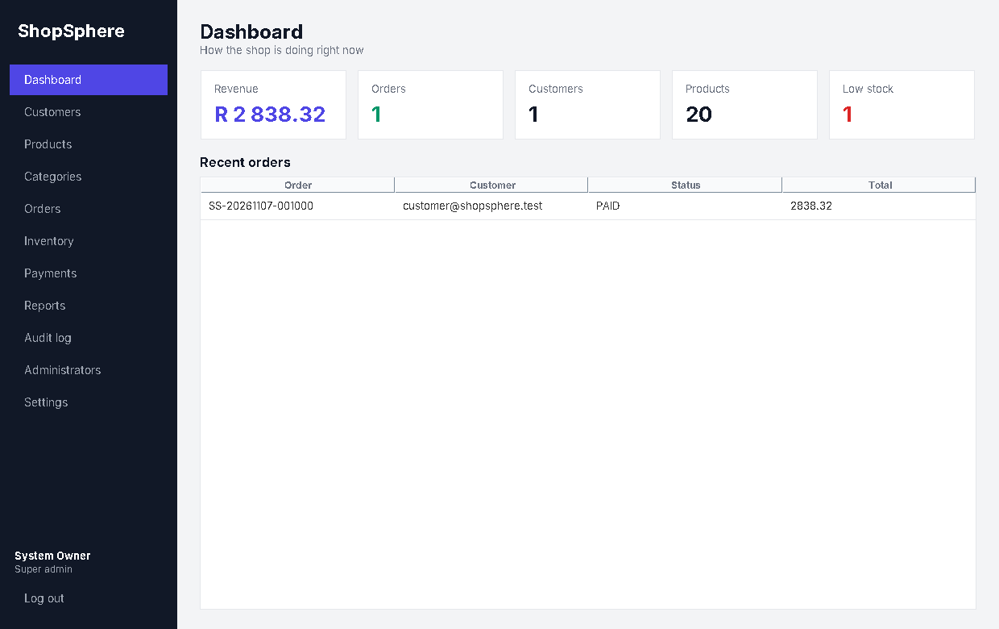
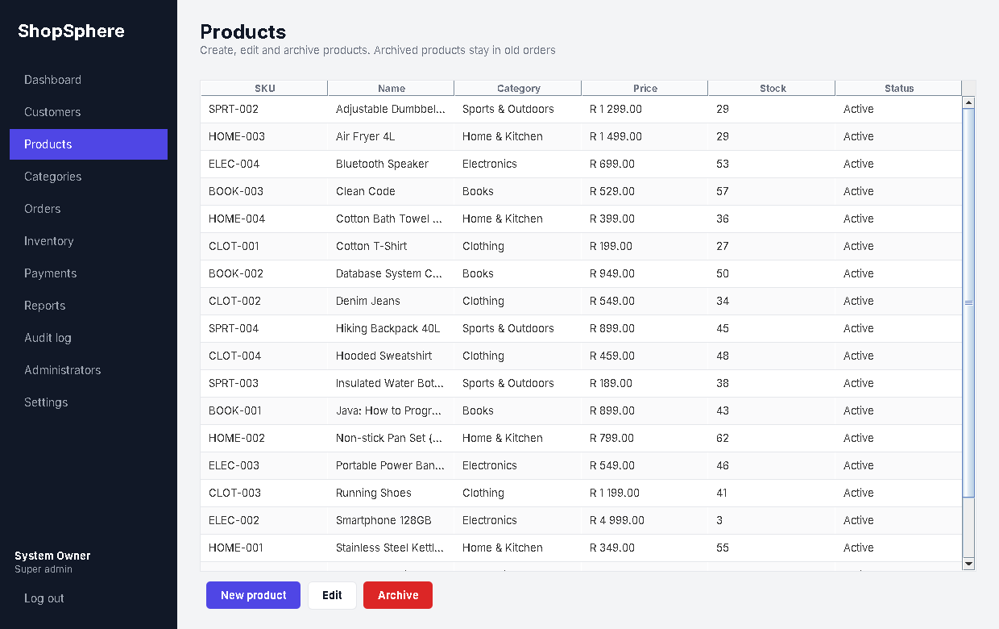

# ShopSphere

ShopSphere is a desktop e-commerce system built with Java 17. It includes a
Swing client, a multi-threaded TCP server, a shared protocol module, JDBC
data access, and PostgreSQL persistence.

> **Payments are simulated.** No real money is charged and only the last four
> digits of a card number are stored.

## Features

- Customer registration, login, profiles, addresses, carts, wishlists, orders, and reviews
- Product catalogue with categories, search, product images, and archived products
- Transactional checkout with inventory locking, stock restoration, cancellation, and idempotency
- Simulated payment success, decline, insufficient-funds, refund, and duplicate-payment handling
- Inventory adjustments, stock movement history, and low-stock reporting
- Admin dashboard for customers, products, categories, orders, inventory, payments, reports, and audit logs
- Super-admin management for administrators, roles, and system settings
- PBKDF2 password hashing, session expiration, login lockout, permission checks, and input validation

## Technology

- Java 17
- Maven multi-module build
- Java Swing desktop UI
- Java TCP sockets with filtered serialized request/response objects
- JDBC and PostgreSQL
- JUnit 5
- `java.util.logging`

This project intentionally does not use Spring, Hibernate, JPA, REST, or a
web frontend.

## Architecture

```text
Swing client
    │ TCP
    ▼
ShopServer → RequestRouter → Services → DAOs → JDBC → PostgreSQL
                 │
                 └── permission and session checks
```

Modules:

| Module | Responsibility |
| --- | --- |
| `shopsphere-common` | Shared commands, DTOs, protocol objects, and enums |
| `shopsphere-server` | TCP server, security, services, validation, DAOs, and configuration |
| `shopsphere-client` | Swing screens, typed API client, and asynchronous UI calls |

More detail is available in [`docs/ARCHITECTURE.md`](docs/ARCHITECTURE.md),
[`docs/DATABASE.md`](docs/DATABASE.md), and [`docs/PROTOCOL.md`](docs/PROTOCOL.md).

## Requirements

- JDK 17 or newer
- Maven 3.8 or newer
- PostgreSQL 14 or newer

## Database setup

Create a database and user in PostgreSQL:

```sql
CREATE ROLE shopsphere LOGIN PASSWORD 'choose-a-password';
CREATE DATABASE shopsphere OWNER shopsphere;
```

Load the schema and development data:

```bash
psql -U shopsphere -d shopsphere -f database/schema.sql
psql -U shopsphere -d shopsphere -f database/seed.sql
```

The seed data creates 5 categories, 20 products, and these development-only
accounts:

| Account | Email | Password |
| --- | --- | --- |
| Customer | `customer@shopsphere.test` | `Customer#123` |
| Admin | `admin@shopsphere.test` | `Admin#12345` |

Remove or change these accounts before using the application outside local
development.

## Configuration

Copy `config/server.local.properties.example` to
`config/server.local.properties` and set your database credentials. The local
file is ignored by Git.

Environment variables take precedence over the properties file:

| Variable | Default | Description |
| --- | --- | --- |
| `SHOPSPHERE_DB_URL` | `jdbc:postgresql://localhost:5432/shopsphere` | JDBC URL |
| `SHOPSPHERE_DB_USER` | `shopsphere` | Database user |
| `SHOPSPHERE_DB_PASSWORD` | empty | Database password |
| `SHOPSPHERE_PORT` | `5555` | Server port |
| `SHOPSPHERE_HOST` | `localhost` | Client server host |
| `SHOPSPHERE_MAX_CLIENTS` | `50` | Maximum simultaneous clients |
| `SHOPSPHERE_SESSION_MINUTES` | `30` | Idle session timeout |
| `SHOPSPHERE_PBKDF2_ITERATIONS` | `210000` | Password hashing cost |
| `SHOPSPHERE_MAX_FAILED_LOGINS` | `5` | Login attempts before lockout |
| `SHOPSPHERE_LOCK_MINUTES` | `15` | Login lockout duration |
| `SHOPSPHERE_SUPERADMIN_EMAIL` | empty | First super-admin email |
| `SHOPSPHERE_SUPERADMIN_PASSWORD` | empty | First super-admin password |

The first super-admin is created only when no super-admin exists yet.

## Build and run

From the project root:

```bash
mvn clean install
```

Start the server:

```bash
mvn -pl shopsphere-server exec:java
```

Start a client in another terminal:

```bash
mvn -pl shopsphere-client exec:java
```

Run the test suite:

```bash
mvn test
```

Database tests are skipped unless `SHOPSPHERE_TEST_DB_URL` points to a
database whose name ends with `_test`. They recreate the test schema, so do
not point them at a production database.

## Screenshots

### Customer shop



### Admin dashboard



### Admin products



## Known limitations

- Payments are simulated. Card `4242 4242 4242 4242` succeeds, a card ending in `0002` is declined, and one ending in `9995` has insufficient funds.
- Product images are stored as references; the client displays a placeholder tile.
- TCP traffic is not encrypted. Use the application only on a trusted network or place TLS in front of it.
- The protocol uses filtered Java serialization rather than a text protocol.
- There is no email service or email-based password reset.

## License

No license has been specified yet.
